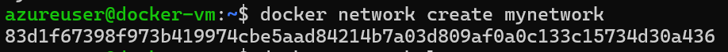
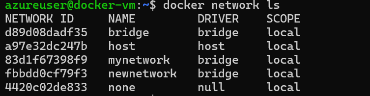
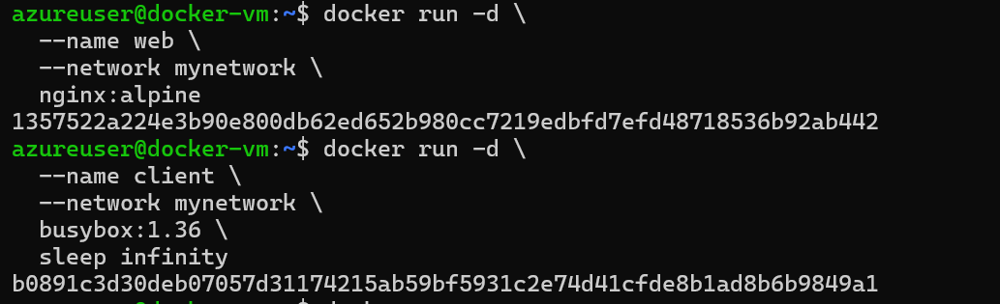
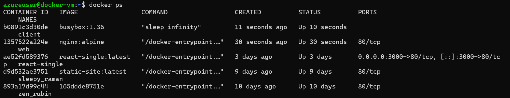
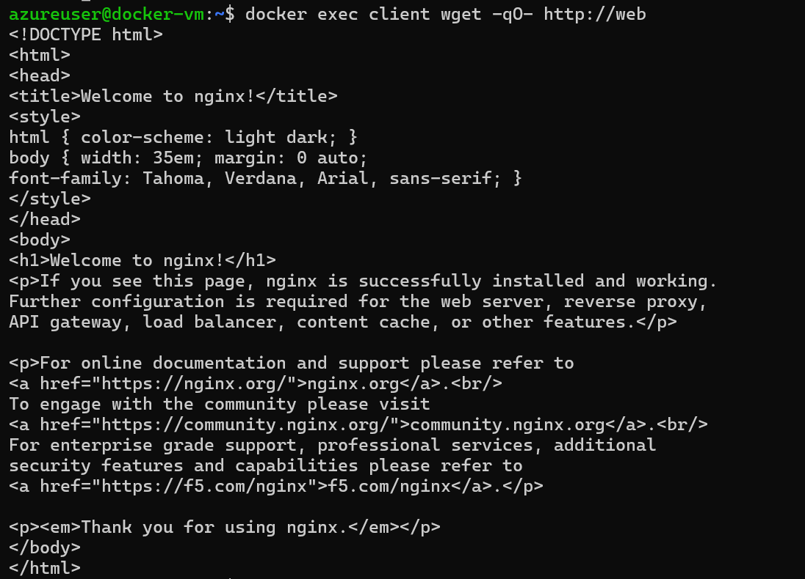
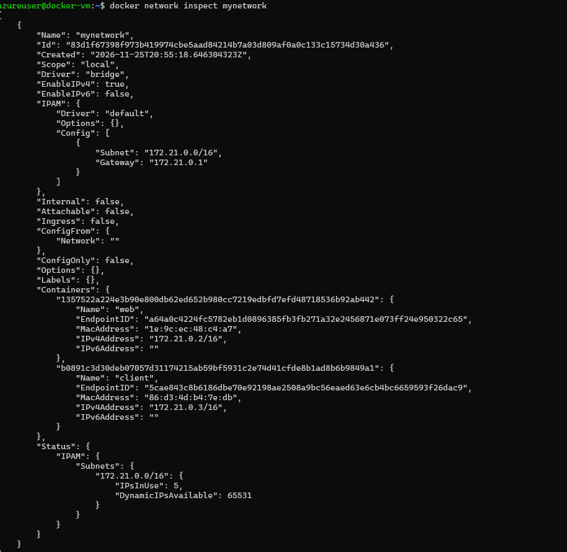

# Task 1 — Deploy a Standalone Application Using the Default Bridge Network
The goal is to deploy an Nginx web server using Docker’s default bridge network and access it through the VM Public IP address.
1. Pull the required image from docker registry using:
   
```bash
docker pull nginx:alpine
```


2. Run the nginx on the default bridge network using the command
 ```bash
docker run -d \
  --name myweb \
  -p 80:80 \
  nginx:alpine
```


3. check the running containers using

```bash
docker ps
```
   


4. The container should be accessible via localhost (the VM public ip address/port)
   
```bash
http://20.90.12.64:80
```


# Task 2 — Connect Containers Using a Custom Bridge Network
with custom bridge network and verify thacontainers can communicate using container names rather than IP addresses..
1. create a custome bridge network named **mynetwork**
```bash
   docker network create mynetwork
```


2. Confirm the network was created using the command
```bash
   docker network ls
```


3. Create and run two containers web and client using the following command
 ```bash
   docker run -d \
  --name web \
  --network mynetwork \
  nginx:alpine


docker run -d \
  --name client \
  --network mynetwork \
  busybox:1.36 \
  sleep infinity

```


4. Check the containers created using
   
```bash
docker ps
```


5.  verify you can reach web container from clinet container using

```bash
   docker exec client wget -qO- http://web
```


6. inspect the  **mynetwork** network created

ypu can see that the client and web both belong to the same network and that is wht they can communicate with each other

# Task 3 — Demonstrating Multi-Network Isolation
 The goal is to deploy frontend, backend, and database containers across two separate Docker networks - **frontend network and backend network**. Also ensure frontend container cannot directly reach the database container
 The frontend-network will connect both the frontend  and backend containers. This is to allow communication between the frontend and backend . The backend-network on the other hand will connect both the frontend and backend containers. This is to allow communication between the db and backend 
 You might assume that because the backend container is connected to both networks, Docker will automatically take traffic from one network and forward it to the other. That is not what happens. Being connected to two networks simply gives the backend container network interfaces on both networks.

 1. Create the Two Networks
    
```bash
   docker network create frontend-network

   docker network create backend-network
```


 2. Verify the Two Networks created

```bash
   docker network ls
```


3. Run the two containers **database and backend container**
```bash
   docker run -d \
  --name db \
  --network backend-network \
  mongo:7.0


   docker run -d \
     --name backend \
     --network backend-network \
     nginx:alpine

```
4. Connect the backend container to the frontend network using this syntax:
```bash
   docker network connect NETWORK_NAME CONTAINER_NAME
```
NETWORK_NAME is frontend-network
CONTAINER_NAME is backend


5. Run the **frontend container**
```bash
   docker run -d \
     --name frontend \
     --network frontend-network \
     -p 80:80 \
     nginx:alpine
```
6. Verify if the 3 containers are running using
```bash
   docker ps
```
7. inspect the frontend network to see the containers connected to it using
```bash
   docker network inspect frontend-network
```


8. inspect the backend network to see the containers connected to it using
```bash
   docker network inspect backend-network
```


9.  Verify Frontend-to-Backend Communication of the container using this command
```bash
   docker exec frontend wget -qO- http://backend
```


The Nginx Welcome Page HTML is returned.

This proves that frontend can reach backend because both containers share frontend-network.

10. Verify Backend-to-Database Communication
this can be done Installing a network testing tool in the backend container using this commnad
```bash
   docker exec backend apk add --no-cache netcat-openbsd
```
Then test connectivity to MongoDB:
```bash
   docker exec backend nc -zv -w 5 db 27017
```


11. Verify if Frontend can reach Database, use this command
```bash
    docker exec frontend apk add --no-cache netcat-openbsd
```


12. Verifying Public Access to the Frontend Only


# Deploy an Application Using Docker Host Network
The Host network mode uses the VM’s ports directly.
1.  Run Nginx with Host Networking
```bash
   docker run -d \
  --name fastapp \
  --network host \
  nginx:alpine
```
2. verify the conatainer is running without a port mapping
```bash
 docker ps
```


3. inspect the network mode to see if it is running on host using
```bash
   docker inspect fastapp | grep '"NetworkMode"
```

