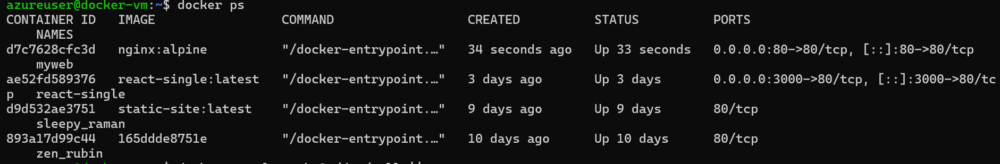
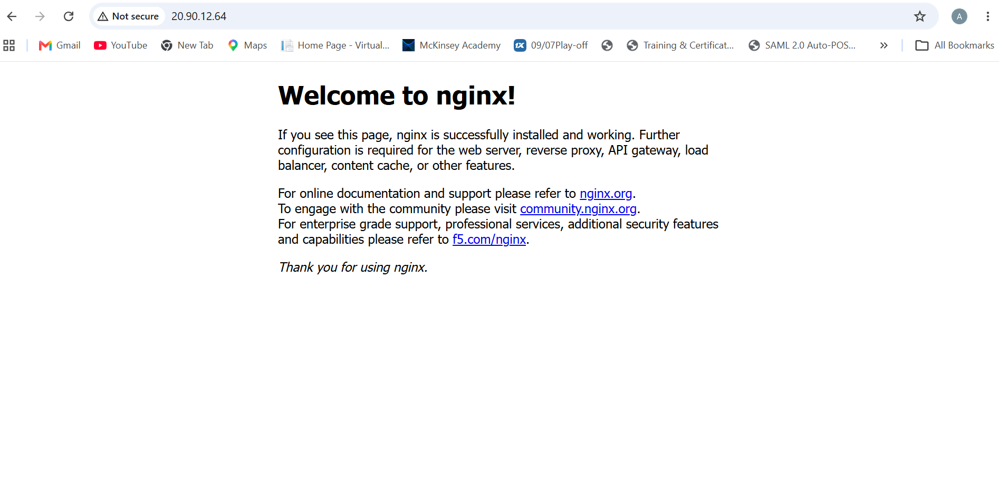

# Task 1 — Deploy a Standalone Application Using the Default Bridge Network
The goal is to deploy an Nginx web server using Docker’s default bridge network and access it through the VM Public IP address.
1. Pull the required image from docker registry using:
   
```bash
docker pull nginx:alpine
```


2. Run the nginx on the default bridge network using the command
 ```bash
docker run -d \
  --name myweb \
  -p 80:80 \
  nginx:alpine
```


3. check the running containers using

```bash
docker ps
```
   


4. The container should be accessible via localhost (the VM public ip address/port)
   
```bash
http://20.90.12.64:80
```



# Task 2 — Connect Containers Using a Custom Bridge Network
with custom bridge network and verify thacontainers can communicate using container names rather than IP addresses..
1. create a custome bridge network named **mynetwork**
```bash
   docker network create mynetwork
```
2. Confirm the network was created using the command
```bash
   docker network ls
```
3. Create and run two containers web and client using the following command
 ```bash
   docker run -d \
  --name web \
  --network mynetwork \
  nginx:alpine


docker run -d \
  --name client \
  --network mynetwork \
  busybox:1.36 \
  sleep infinity

```

4. Check the containers created using
   
```bash
docker ps
```
5.  verify you can reach web container from clinet container using
